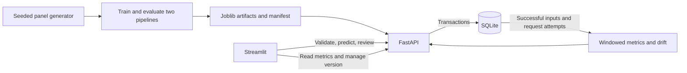

# Architecture and data decisions

The Streamlit user interface (UI) uses FastAPI as its application programming interface (API) for prediction, review and monitoring. See the [English–Chinese glossary](glossary.md) for terms used below.

## Data and model

The simulator draws four numeric fields with weak latent correlations. A noisy nonlinear logistic rule generates a binary *simulated need for review*. It introduces training missingness after drawing the label. Seed 42 produces 2,400 panels, split once into 1,800 training and 600 stratified holdout rows. Both releases use the same split. Preprocessing fits the training medians and scaling parameters inside the pipeline. Inference loads that fitted pipeline. The model manifest records the generator ID, seed, feature order, library version, holdout metrics, training distribution bins and each file checksum. The area under the receiver operating characteristic curve (ROC AUC) summarizes how well a model ranks positives above negatives. Average precision summarizes the trade-off between precision and recall as the threshold changes. Both are illustrative offline metrics on synthetic labels. The 0.50 display threshold has no clinical calibration.

The input contract requires all four keys. Hemoglobin needs a finite numeric value. At most one of white blood cells, platelets or mean corpuscular volume may be explicitly null. Types and broad ingestion bounds catch likely formatting or unit mistakes. They carry no clinical interpretation. A one-row-at-a-time comma-separated values (CSV) import keeps validation and review behavior the same for uploaded and built-in examples.

The University of California, Irvine (UCI) Chronic Kidney Disease (CKD) dataset has 400 historical records and includes diagnostic correlates such as serum creatinine. A real benchmark would require defining the time of prediction and verifying which variables are available then. A simulator makes demo edge cases reproducible and decouples the example from any disease or institution. [UCI CKD dataset](https://archive.ics.uci.edu/dataset/336/chronic)

## Serving, audit and release control

Each request identifier (ID) uses a Universally Unique Identifier (UUID). In the Hypertext Transfer Protocol (HTTP), this service uses GET to read records and POST to submit data or initiate an action.

| Operation | Behavior |
| --- | --- |
| `POST /predictions` | Normalize numeric inputs and bind the request UUID to one panel. Same panel replays the saved response. Different valid panel with the same UUID returns 409. Invalid input returns 422. |
| `GET /predictions` and `GET /predictions/{id}` | List recent cases and show the saved panel, timestamp, score, version, checksum and review history. |
| `POST /predictions/{id}/reviews` | Append a reviewer alias, disposition and note with a review UUID. Retrying identical feedback reuses the event. Flagging requires a note. |
| `GET /models` and `POST /models/activate` | Compare releases on the same holdout and record a version switch with a reason. Rollback is the same operation targeting an older release. |
| `GET /monitor` and `GET /health` | Read operational metrics or API readiness. |

A SQLite write transaction serializes the duplicate check, model selection and insert. This keeps a second process from scoring the same ID and establishes a clear order between accepting a new request and activating a model. The cost is one write lane during inference. SQLite write-ahead logging (WAL) permits readers to access an existing snapshot while a write is in progress. The active version is the last activation event and survives restarts. For this two-release demo both models load at startup. Bindings prevent a version name in the database from silently pointing to different bytes. Load the joblib files only from the locally generated, trusted release. The manifest checksum detects a mismatched artifact. It provides no signature or independent trust anchor.

A failure before prediction commit leaves the request ID available for retry. Attempt telemetry is best effort and has its own transaction, so a telemetry write failure can undercount attempts without invalidating a committed result. A reviewer alias is self-entered. Review events have application-level history, with no authentication or tamper protection. The activation controls share the same local demo boundary.

## Monitoring

| Signal | Definition |
| --- | --- |
| Request volume | Number of prediction POST attempts in the selected time window, including replays and failures. Unique predictions have their own count. |
| Latency | The 95th percentile (p95) of API handling time in milliseconds (ms). About 95% of requests complete within that duration. Excludes telemetry persistence and network time. |
| Failure rate | HTTP status ≥400 divided by prediction POST attempts. Validation and service failures are shown separately. |
| Missingness | Per-field proportion of panel objects with an absent or null field. Includes rejected payloads with a panel object and retries. Malformed JavaScript Object Notation (JSON) has no measurable panel. |
| Input drift | Compare fixed training quantile-bin frequencies with successful unique panels. Nulls are excluded feature by feature, with counts shown. Total variation distance is half the sum of absolute bin-frequency differences. The demo signals at 0.20 with at least 20 observations. |

The drift scenario adds 5 simulator units to the mean white blood cell signal and increases simulated missingness. It posts 30 valid panels with stable IDs. The threshold and minimum count are demonstration settings. Observed shifts can come from ingestion changes, workflow changes, or a different population. Assessing performance requires trustworthy outcomes linked to predictions. Reviewers see the model output, so their feedback may be influenced by it. Feedback stays in the review history and is excluded from automatic retraining.

## Public context

The public Clinical AI Readiness Evaluator (CARE) paper describes eight workstreams spanning use case, data, pipeline, code, user experience, infrastructure, orchestration and regulatory compliance. Here it informs the decision to show a full workflow on synthetic data. The interview discussions about deployment, repetitive work and use of results motivated the walkthrough. The exact data and workflow for the role are unspecified. [CARE lifecycle overview](https://pubmed.ncbi.nlm.nih.gov/40650598/)
